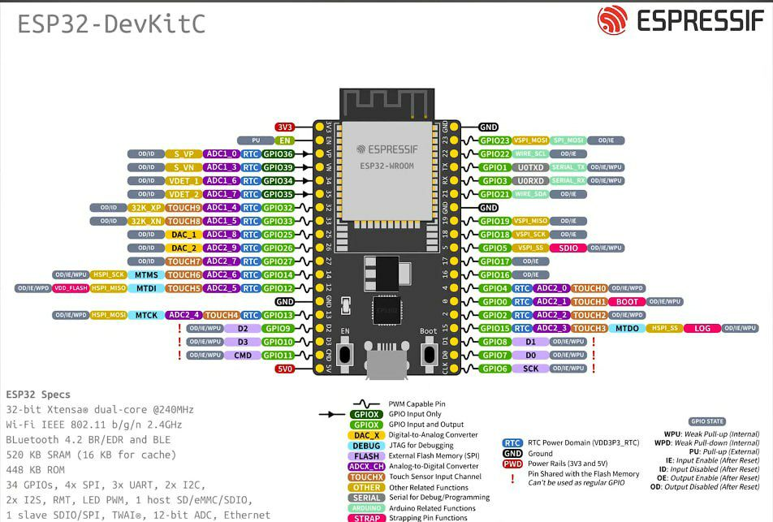
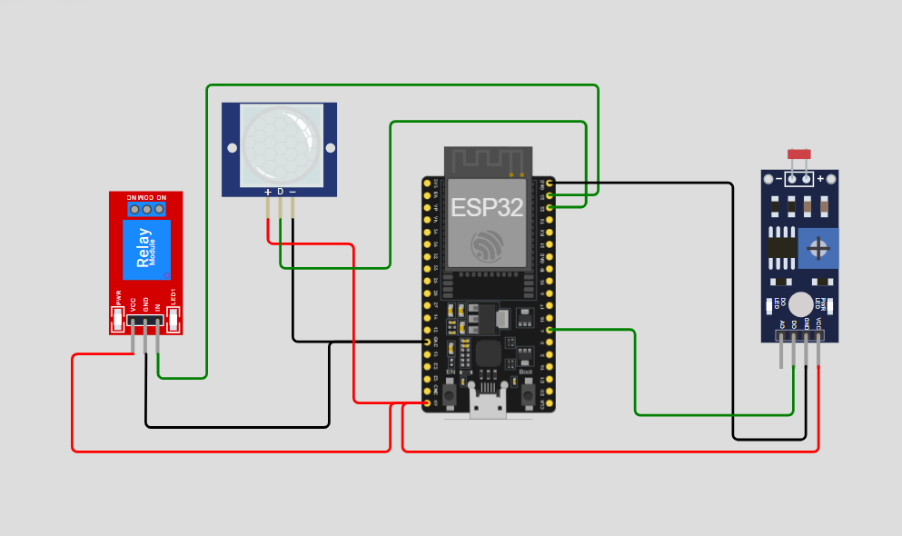

# 💡 Smart Lighting System Using ESP32, Bluetooth, LDR & PIR Sensor

## 📌 Overview

The **Smart Lighting System** is an IoT-based project designed to automate lighting control using an ESP32 microcontroller. The system uses an **LDR (Light Dependent Resistor)** to detect ambient light intensity and a **PIR (Passive Infrared) sensor** to detect human motion.

It also supports **Bluetooth communication**, allowing users to control the light remotely using a smartphone.

The system provides two operating modes:

- **Automatic Mode:** The light turns ON when the environment is dark and motion is detected. Otherwise, it remains OFF.
- **Manual Mode:** The user can turn the light ON or OFF directly through Bluetooth commands.

This project aims to improve energy efficiency, reduce unnecessary electricity consumption, and provide convenient lighting control.

---

## ✨ Features

- 🔆 **Automatic Lighting Control:** Controls the light based on environmental brightness and motion detection.
- 🌙 **LDR-Based Light Detection:** Detects ambient light conditions.
- 🚶 **Motion Detection:** Uses a PIR sensor to detect human presence.
- 📱 **Bluetooth Control:** Allows remote light control using a smartphone.
- ⚙️ **Dual Operating Modes:** Supports both Automatic and Manual modes.
- 🔌 **Relay-Based Switching:** Controls an external light using a relay module.
- ♻️ **Energy Efficiency:** Helps reduce electricity consumption by keeping lights OFF when they are not needed.

---

## 🛠️ Hardware Requirements

| Component | Quantity | Description |
|---|---:|---|
| ESP32 Development Board | 1 | Main microcontroller |
| LDR Sensor / Digital Light Sensor Module | 1 | Detects ambient light |
| PIR Motion Sensor | 1 | Detects human movement |
| Relay Module | 1 | Controls the light |
| Light Bulb | 1 | Lighting load |
| Jumper Wires | As needed | Circuit connections |
| Breadboard | 1 | Prototyping |
| Power Supply | 1 | Powers the circuit |

---

## 🔌 Pin Connections

The following table shows the GPIO connections used in the Arduino code.

| ESP32 GPIO | Component | Function |
|---|---|---|
| GPIO 23 | Relay Module | Controls the light |
| GPIO 4 | LDR Module | Reads light intensity |
| GPIO 22 | PIR Sensor | Detects motion |

**Additional connections:**

- Connect the sensor VCC pins to the appropriate power supply.
- Connect the sensor GND pins to ESP32 GND.
- Connect the relay module's VCC and GND according to its specifications.
- Connect the relay input pin to GPIO 23.

> ⚠️ **Safety Note:** If you are controlling an AC light bulb, use a properly rated relay module and follow electrical safety precautions. Never connect AC mains directly to the ESP32. Ensure all mains wiring is properly insulated and enclosed.

---

## ⚙️ How It Works

The system operates using two different modes.

### 1. Automatic Mode

In Automatic Mode, the ESP32 continuously monitors the LDR and PIR sensors.

The light turns ON only when both conditions are satisfied:

1. The environment is dark (LDR output is HIGH in the current code).
2. Motion is detected (PIR output is HIGH).

Otherwise, the light remains OFF.

**Automatic Mode Logic:**

| Environment | Motion | Light |
|---|---|---|
| Dark | Detected | ON |
| Dark | Not detected | OFF |
| Bright | Detected | OFF |
| Bright | Not detected | OFF |

### 2. Manual Mode

In Manual Mode, the user controls the light directly through Bluetooth.

The system receives commands from a smartphone and switches the relay accordingly.

| Bluetooth Command | Action |
|---|---|
| `1` | Turn ON the light |
| `0` | Turn OFF the light |
| `2` | Switch to Manual Mode |
| `3` | Switch to Automatic Mode |

**Note:** Commands `1` and `0` only work when Manual Mode is active.

---

## 📱 Bluetooth Communication

The ESP32 uses the `BluetoothSerial` library to establish Bluetooth Classic communication.

The Bluetooth device name is:

`Bluetooth Light Bulb System`

### How to Control the System

1. Power on the ESP32.
2. Enable Bluetooth on your smartphone.
3. Pair with the device named **Bluetooth Light Bulb System**.
4. Open a Bluetooth Serial Terminal application or configure the buttons.
5. Connect to the ESP32.

---

## 💻 Software Requirements

- [Arduino IDE](https://www.arduino.cc/en/software)
- ESP32 Board Package for Arduino IDE
- BluetoothSerial library (included with the ESP32 Arduino Core)
- Bluetooth Serial Terminal application for smartphone control

---

## 🚀 Installation and Setup

Follow these steps to run the project:

### Step 1: Clone the Repository

```bash
git clone https://github.com/YOUR_USERNAME/YOUR_REPOSITORY_NAME.git
```

### Step 2: Open the Project

Open the Arduino `.ino` file using Arduino IDE.

### Step 3: Configure the ESP32

- Install the ESP32 board package.
- Select your ESP32 development board.
- Select the correct COM port.

### Step 4: Connect the Hardware

Connect the LDR, PIR sensor, and relay module according to the pin connection table.



---



### Step 5: Upload the Code

Upload the Arduino sketch to the ESP32.

### Step 6: Test the System

Test both Automatic and Manual modes to verify that the system works correctly.

---

## 🧠 Control Logic

The main control logic can be summarized as follows:

```text
          START
            |
            v
      Initialize ESP32
            |
            v
     Check Bluetooth
            |
            v
       Select Mode
        /       \
       /         \
   MANUAL        AUTO
     |             |
     v             v
 Bluetooth      Read LDR
 Commands       and PIR
     |             |
     v             v
  ON / OFF     Dark AND Motion?
                   |
              YES / \ NO
                 /   \
                v     v
              LIGHT  LIGHT
                ON    OFF
```

## 🔮 Future Improvements

Some possible improvements for future versions include:

- 🌐 Wi-Fi control through a web application.
- 📲 Development of a dedicated Android application.
- ⏱️ Adjustable automatic lighting delay.
- 📊 Real-time monitoring of sensor readings.
- 🏠 Integration with smart home platforms.
- 🔋 Low-power operation for improved energy efficiency.

---

## 🎯 Project Objectives

The main objectives of this project are:

- To develop an intelligent lighting control system.
- To combine motion and light sensors for automated operation.
- To implement wireless communication using Bluetooth.
- To provide users with both automatic and manual control.
- To contribute to energy conservation through smart automation.
